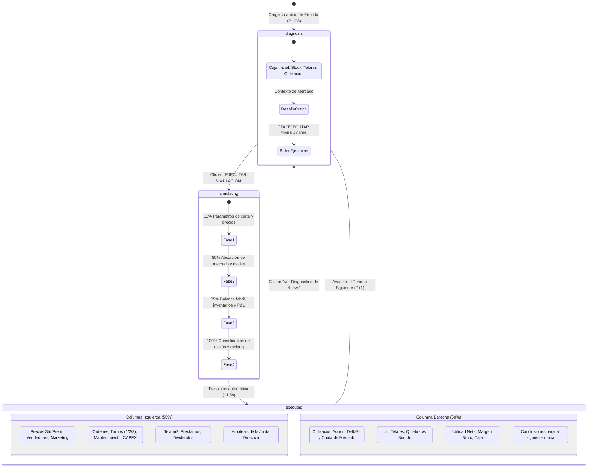
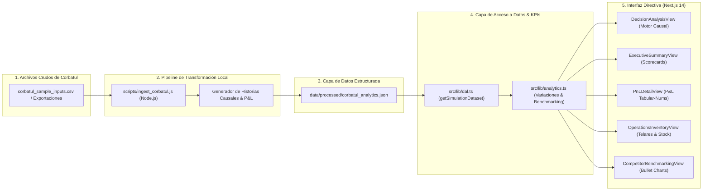

# Contrato de Especificación de Producto y Diseño de Sistema (PRD / SDD)
**Plataforma de Analítica Ejecutiva y Soporte a la Decisión Corbatul & Co.**

- **Versión del Contrato:** 2.1 (Alineada al Estado del Sistema Actual)
- **Metodología:** Spec-Driven Development (SDD) & Arquitectura Local-First
- **Firma Principal:** Firma 3 (*Sideral Textil*)
- **Competidores del Mercado:** Firmas 1, 2, 4 y 5 (Industria Textil / Confección de Corbatas)
- **Alcance Temporal:** 8 Periodos Simulados (Rondas 1 a 8)
- **Audiencia de Entrega:** Junta Directiva, Comité Evaluador y Alta Gerencia

---

## 1. Resumen Ejecutivo y Propósito del Sistema

El simulador **Corbatul** modela la dinámica competitiva de empresas manufactureras textiles dedicadas a la producción y comercialización de corbatas (línea Estándar en poliéster y línea Premium en seda natural). 

El propósito de este sistema es servir como **soporte visual e interactivo de alto impacto para la defensa de resultados ante una Junta Directiva**. A diferencia de dashboards estáticos convencionales, esta plataforma implementa un **Motor Causal de Decisiones** que conecta las decisiones adoptadas en cada ronda con sus impactos inmediatos en operaciones, tesorería, Estado de Resultados (P&L), cuota de mercado y cotización bursátil.

### Principios Fundamentales del Contrato:
1. **Zero-Cloud Overhead (100% Local-First):** Ingesta, almacenamiento, analítica y renderizado se ejecutan íntegramente en local sin dependencias de bases de datos remotas ni servicios cloud de pago.
2. **Trazabilidad Causa-Efecto:** Cada variación financiera ($\Delta\%$) y operativa se explica mediante la correlación directa entre la decisión tomada y la respuesta algorítmica del mercado.
3. **Polaridad Contable Rigurosa:** Las variaciones en costos y gastos reconocen que un aumento es desfavorable (alerta roja), mientras que en ingresos y utilidades es favorable (verde).
4. **Arquitectura Desacoplada:** La lógica analítica reside en funciones puras y contratos TypeScript inmutables, completamente independientes de la capa de visualización React/Next.js.

---

## 2. Máquina de Estados del Motor Causal de Simulación

El componente central de evaluación directiva (`DecisionAnalysisView.tsx`) opera bajo una **Máquina de Estados Finitos (FSM)** que guía la narrativa de la presentación:



### Especificación de los Estados:
1. **`diagnosis` (Pantalla Completa Pre-Ejecución):**
   - Presenta el punto de partida heredado de la ronda anterior: Liquidez en caja, stock remanente, telares disponibles y cotización bursátil con posición en el ranking de la industria.
   - Enuncia el contexto cualitativo y el **Desafío Crítico a Resolver**.
   - Expone el botón de acción principal: `▶ EJECUTAR SIMULACIÓN CON DECISIONES ➔`.
2. **`simulating` (Animación Cinemática Transicional):**
   - Entorno visual inmersivo con radar giratorio y pulso.
   - Duración fija de $1500\,\text{ms}$ con 4 pasos secuenciales de micro-textos que reflejan los módulos internos del simulador Corbatul.
3. **`executed` (Pantalla Dividida Post-Ejecución 50% / 50%):**
   - **Columna Izquierda (Decisiones):** Muestra los 4 ejes de la Hoja de Decisiones oficial de Corbatul y la Hipótesis Estratégica formulada por el equipo directivo.
   - **Columna Derecha (Resultados):** Despliega el impacto bursátil, veredicto de operaciones (tasa de utilización y quiebre de stock), veredicto del P&L (Margen Bruto y Utilidad Neta) y la lección aprendida.
4. **`matrix` (Vista Alternativa Transversal):**
   - Tabla consolidada que compara las decisiones de los 8 periodos en una sola matriz para auditorías globales.

---

## 3. Diccionario Formal de Métricas y Polaridad Contable

### 3.1. Fórmulas de Negocio Corbatul

| Métrica | Fórmula Matemática | Unidad | Relevancia Directiva |
| :--- | :--- | :--- | :--- |
| **Margen Bruto** | $\frac{\text{Ingresos Totales} - \text{COGS}}{\text{Ingresos Totales}} \times 100$ | $\%$ | Eficiencia industrial y poder de fijación de precios antes de gastos operativos. |
| **Costo Unitario de Producción (CUP)** | $\frac{\text{Materia Prima} + \text{Mano de Obra} + \text{CIF} + \text{Depreciación}}{\text{Unidades Confeccionadas Efectivas}}$ | $\$ / \text{unidad}$ | Eficiencia de escala fabril y absorción de costos fijos por turno. |
| **Tasa de Utilización de Planta** | $\frac{\text{Producción Total Real}}{\text{Capacidad Práctica Disponible}} \times 100$ | $\%$ | Medición de capacidad ociosa vs. sobrecarga laboral (Turnos 2 y 3). |
| **Tasa de Quiebre de Stock** | $\frac{\text{Demanda Insatisfecha}}{\text{Demanda Total Potencial}} \times 100$ | $\%$ | Pérdida de ventas e ingresos por subestimación del mercado o falta de telares. |
| **Cuota de Mercado (Unidades)** | $\frac{\text{Unidades Vendidas Firma 3}}{\sum_{i=1}^{5} \text{Unidades Vendidas Firma } i} \times 100$ | $\%$ | Dominio de mercado frente a los rivales del sector textil. |
| **Valor de la Empresa (Enterprise Value)** | $(\text{Acciones} \times \text{Cotización}) + \text{Deuda Financiera} - \text{Caja}$ | $\$$ | Riqueza patrimonial generada para los accionistas al cierre de ronda. |

### 3.2. Contrato de Polaridad Contable en Variaciones ($\Delta\%$)

Toda variación de periodo a periodo se calcula como:
$$\Delta\% = \frac{Valor_t - Valor_{t-1}}{|Valor_{t-1}|} \times 100$$

Para evitar lecturas erróneas durante la exposición ante el directorio, se estipula la siguiente regla de semántica contable:

```typescript
type Polarity = 'revenue' | 'expense';

// Regla de color y semántica:
if (Math.abs(deltaPercent) < 0.05) {
  // Zona neutral: Sin variación material
  semantic = 'NEUTRAL'; // Color: zinc-500 (Gris)
} else if (polarity === 'revenue') {
  // En ingresos, utilidad y márgenes: aumento es positivo
  semantic = deltaPercent > 0 ? 'FAVORABLE' : 'UNFAVORABLE'; // tweed (verde) vs rust (rojo)
} else {
  // En costos, gastos, horas extras y deuda: aumento es desfavorable
  semantic = deltaPercent > 0 ? 'UNFAVORABLE' : 'FAVORABLE'; // rust (rojo) vs tweed (verde)
}
```

---

## 4. Esquema Unificado de Entidades TypeScript (`types/corbatul.ts`)

A continuación se formaliza el contrato de tipos inmutable del sistema:

```typescript
// 1. Hoja de Decisiones Corbatul (Entrada Paramétrica)
export interface PeriodDecision {
  period: number;
  firmId: string;
  priceStandard: number;
  pricePremium: number;
  marketingBudget: number;
  salesForceHeadcount: number;
  productionOrdersStandard: number;
  productionOrdersPremium: number;
  plantShifts: 1 | 2 | 3;
  maintenanceBudget: number;
  qualityControlBudget: number;
  plantExpansionUnits: number;
  rawMaterialPurchaseStandard: number;
  rawMaterialPurchasePremium: number;
  shortTermLoanRequest: number;
  longTermDebtRepayment: number;
  dividendPayoutRatio: number;
}

// 2. Historia Causal de la Decisión (Triada: Diagnóstico -> Decisión -> Consecuencias)
export interface RoundDecisionStory {
  period: number;
  firmId: string;
  roundTitle: string;
  strategicTheme: string;
  
  // Diagnóstico Inicial
  initialState: {
    cashStarting: number;
    inventoryStartingUnits: number;
    nominalCapacity: number;
    inheritedSharePrice: number;
    inheritedRank: number;
    inheritedMarketShare: number;
    diagnosticContext: string;
    criticalChallenge: string;
  };

  // Parámetros de Decisión Adoptados
  decisions: {
    commercial: {
      priceStandard: number;
      pricePremium: number;
      marketingBudget: number;
      salesForceCount: number;
      commercialRationale: string;
    };
    production: {
      ordersStandard: number;
      ordersPremium: number;
      plantShifts: 1 | 2 | 3;
      maintenanceBudget: number;
      qualityControlBudget: number;
      plantExpansionUnits: number;
      productionRationale: string;
    };
    sourcing: {
      rawMaterialStandard: number;
      rawMaterialPremium: number;
      sourcingRationale: string;
    };
    finance: {
      shortTermLoan: number;
      debtRepayment: number;
      dividendPayout: number;
      financeRationale: string;
    };
    strategicHypothesis: string;
  };

  // Consecuencias Causales de la Simulación
  consequences: {
    operationalImpact: {
      unitsProduced: number;
      utilizationRate: number;
      overtimeIncidence: string;
      machineBreakdowns: string;
      stockoutOccurred: boolean;
      stockoutUnits: number;
      operationalVerdict: string;
    };
    financialImpact: {
      totalRevenue: number;
      grossProfit: number;
      grossMargin: number;
      cogsSummary: string;
      netIncome: number;
      netMargin: number;
      endingCash: number;
      financialVerdict: string;
    };
    competitiveImpact: {
      endingSharePrice: number;
      sharePriceDelta: number;
      marketShare: number;
      marketRank: number;
      competitorMovements: string;
    };
    lessonsLearned: string;
  };
}

// 3. Estados Financieros Completos (P&L y Balance)
export interface CompanyFinancials {
  period: number;
  firmId: string;
  revenueStandard: number;
  revenuePremium: number;
  totalRevenue: number;
  costOfGoodsSold: {
    rawMaterialsUsed: number;
    directLaborRegular: number;
    directLaborOvertime: number;
    factoryOverhead: number;
    plantDepreciation: number;
    inventoryHoldingCost: number;
    rejectionAndWasteCost: number;
    totalCOGS: number;
  };
  grossProfit: number;
  grossMargin: number;
  operatingExpenses: {
    marketingAndAdvertising: number;
    salesForcePayroll: number;
    qualityAssurance: number;
    plantMaintenance: number;
    generalAdministrative: number;
    totalOPEX: number;
  };
  ebitda: number;
  ebit: number;
  operatingMargin: number;
  financialResults: {
    interestExpense: number;
    interestIncome: number;
    emergencyFinancingCost: number;
    netFinancialCost: number;
  };
  earningsBeforeTaxes: number;
  incomeTaxes: number;
  netIncome: number;
  netMargin: number;
  balanceSheet: {
    cashAndEquivalents: number;
    accountsReceivable: number;
    inventoriesFinishedGoods: number;
    inventoriesRawMaterials: number;
    netPropertyPlantEquipment: number;
    totalAssets: number;
    shortTermDebt: number;
    accountsPayable: number;
    longTermDebt: number;
    totalLiabilities: number;
    shareholdersEquity: number;
    retainedEarnings: number;
    sharePrice: number;
    sharesOutstanding: number;
    enterpriseValue: number;
  };
}

// 4. Benchmarking Competitivo del Mercado
export interface MarketCompetitorState {
  period: number;
  firmId: string;
  firmName: string;
  marketShareUnits: number;
  marketShareRevenue: number;
  averagePrice: number;
  qualityPerceptionScore: number;
  totalRevenue: number;
  netIncome: number;
  accumulatedNetIncome: number;
  sharePrice: number;
  marketCap: number;
  rankBySharePrice: number;
  rankByMarketShare: number;
  rankByAccumulatedProfit: number;
}

// 5. Contenedor Global del Dataset
export interface SimulationDataset {
  meta: {
    generatedAt: string;
    totalPeriods: number;
    primaryFirmId: string;
    currencySymbol: string;
    firms: { id: string; name: string; isOurFirm: boolean; color: string }[];
  };
  periods: number[];
  decisions: PeriodDecision[];
  decisionStories?: RoundDecisionStory[];
  financials: CompanyFinancials[];
  operations: ProductionMetrics[];
  competitors: MarketCompetitorState[];
  variances: PeriodVarianceAnalysis[];
}
```

---

## 5. Pipeline de Ingesta y Arquitectura Local-First



---

## 6. Especificación de Diseño Visual y Accesibilidad (UI/UX)

1. **Paleta Sartorial Vintage:**
   - Tonos de fondo y estructura: `vintage-950` (`#1A1715`), `vintage-900` (`#26221E`), `vintage-800` (`#3B3530`), `vintage-50` (`#FAF7F2`).
   - Acentos de negocio:
     - `brass-DEFAULT` (`#C49B45`) y `amber-500` para títulos directivos, cotización bursátil y acciones de alto impacto.
     - `tweed` (`#3B6E47`) para utilidades, surtido de pedidos y variaciones favorables.
     - `rust` (`#A33B2B`) para quiebres de stock, costos excesivos y variaciones desfavorables.
     - `denim` (`#2A4A6B`) para inventarios y métricas operativas de taller.
2. **Ratio Dato-Tinta y Legibilidad Directiva:**
   - Tipografía dual: Titulares en tipografía serif con peso black para porte corporativo; cifras contables y porcentajes en `font-mono tabular-nums` para alineación vertical estricta.
   - Eliminación total de fuentes microscópicas: Todo texto de lectura tiene tamaño mínimo `text-xs` ($12\,\text{px}$) y contraste validado según el estándar **WCAG 2.1 AA** sobre fondo blanco nítido (`border-zinc-200`).
3. **Responsive Full-Width:**
   - La aplicación no utiliza contenedores fijos limitados (`max-w-7xl` eliminado). Se expande al 100% del ancho de la pantalla de proyección.
   - Sidebar colapsable con modo compacto de iconos (`w-20`) y modo expandido (`w-72`), preservando el estado activo del periodo seleccionado en todos los componentes.

---

## 7. Protocolo de Verificación y Compilación

Para asegurar la integridad del contrato antes de cualquier presentación ejecutiva:

```bash
# 1. Regenerar datos derivados locales
node scripts/ingest_corbatul.js

# 2. Verificación estricta de tipos de TypeScript
npx tsc --noEmit

# 3. Compilación de producción en Next.js
npm run build
```
Resultado garantizado: `Exit code 0` con todas las rutas estáticas prerenderizadas limpiamente.
